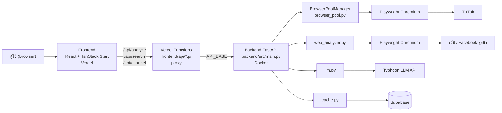
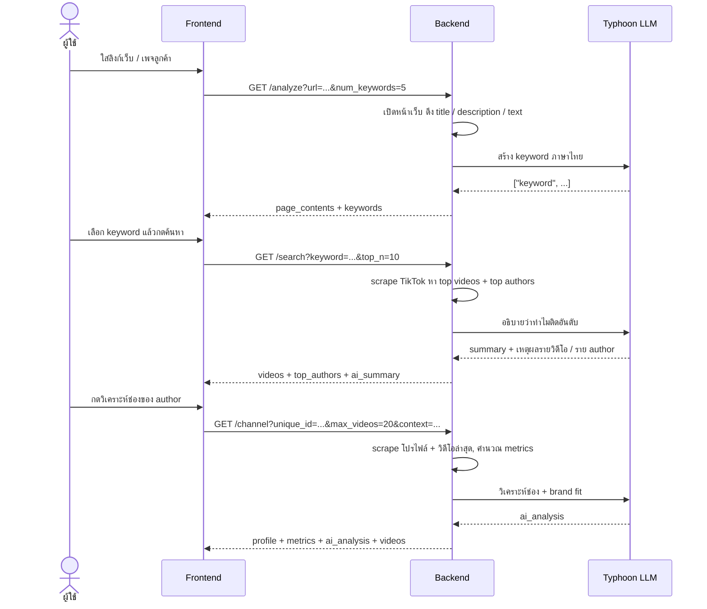
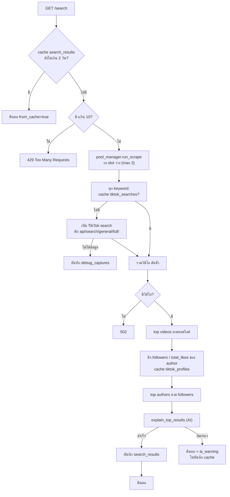
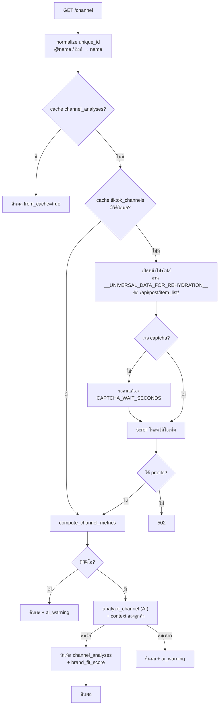
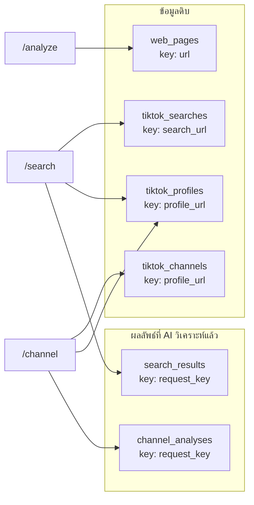

# Diagrams

## 1. Architecture

## 2. User flow (3 ขั้น)

## 3. /search

## 4. /channel

## 5. Cache (Supabase)

ทุกตารางหมดอายุ 2 วัน (`CACHE_TTL`) ถ้าไม่ได้ตั้ง `SUPABASE_URL` / `SUPABASE_KEY` จะข้าม cache ทั้งหมด
