# TikTok Insight: คู่มือการทำงานของระบบ

ระบบนี้ช่วยหาครีเอเตอร์ TikTok ที่เหมาะกับธุรกิจของลูกค้า ผู้ใช้ใส่ลิงก์เว็บหรือเพจ Facebook ของลูกค้า ระบบให้ AI สรุปเป็น keyword แล้วค้น TikTok หาวิดีโอและครีเอเตอร์ที่เด่น จากนั้นวิเคราะห์ช่องที่สนใจเชิงลึกพร้อมให้คะแนนความเหมาะสมกับแบรนด์

ดู diagram ทั้งหมดได้ที่ [diagrams.md](diagrams.md)

---

## 1. Architecture

| ส่วน | เทคโนโลยี | ตำแหน่ง |
|---|---|---|
| Frontend | React 19, TanStack Start / Router, Tailwind 4, shadcn/ui, Vite 8 | `frontend/src/` |
| Proxy | Vercel Functions (prod) / Vite dev proxy (local) | `frontend/api/*.js`, `frontend/vite.config.ts` |
| Backend | FastAPI 0.115, Uvicorn | `backend/src/main.py` |
| Scraper | Playwright (Chromium, headless=False) | `backend/src/tiktok_scraper.py`, `web_analyzer.py` |
| AI | Typhoon LLM ผ่าน OpenAI SDK | `backend/src/llm.py` |
| Cache | Supabase (Postgres + jsonb) | `backend/src/cache.py`, `backend/supabase/schema.sql` |

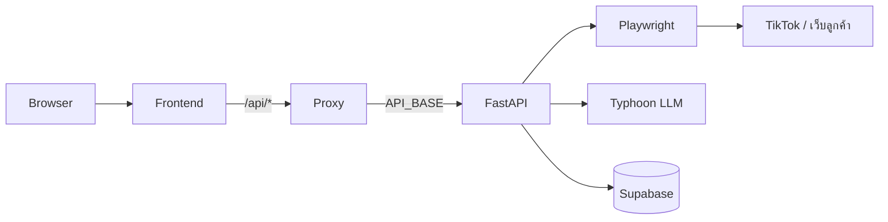

### โครงสร้างไฟล์ backend

| ไฟล์ | หน้าที่ |
|---|---|
| `main.py` | FastAPI app, 3 endpoint, สร้าง cache key, เรียก AI, จัดการ error |
| `web_analyzer.py` | เปิดหน้าเว็บลูกค้า ดึง title / meta description / body text แล้วให้ AI สร้าง keyword |
| `tiktok_scraper.py` | scrape ผลค้นหา TikTok, ยอดผู้ติดตามของ author, โปรไฟล์ + วิดีโอของช่อง |
| `top_analyzer.py` | ให้ AI อธิบายเหตุผลที่วิดีโอ / author ติดอันดับ, ฟังก์ชัน engagement rate |
| `channel_analyzer.py` | คำนวณ metrics ของช่อง และให้ AI วิเคราะห์ช่อง + brand fit |
| `browser_pool.py` | จำกัดจำนวน browser ที่รันพร้อมกันและความยาวคิว |
| `cache.py` | อ่าน / เขียน cache ใน Supabase พร้อม TTL 2 วัน |
| `llm.py` | ส่ง prompt ไป Typhoon แล้วตัด ```` ```json ```` ออก |
| `cookies_utils.py` | แปลง `cookies.json` (export จาก browser extension) เป็นรูปแบบของ Playwright |

### การเชื่อม frontend → backend

ฝั่ง frontend เรียก API ผ่าน [frontend/src/lib/api.ts](../frontend/src/lib/api.ts) โดยใช้ base URL `/api` เป็นค่าเริ่มต้น

- **Local (vite dev)**: `vite.config.ts` proxy `/api/*` ไปที่ `API_BASE` (default `http://127.0.0.1:8000`) และตัด `/api` ออก
- **Production (Vercel)**: `frontend/api/analyze.js`, `search.js`, `channel.js` เป็น serverless function ที่ส่งต่อ query string ไปยัง `${API_BASE}/<endpoint>` (timeout 120 วินาทีตาม `vercel.json`) ส่วน `api/ssr.js` render หน้าเว็บแบบ SSR
- เปลี่ยน base URL ได้จากปุ่ม Settings บนหน้าเว็บ (ค่าเก็บใน `localStorage` key `tt_api_base`) เช่นใส่ `http://127.0.0.1:8000` เพื่อเรียก backend ตรง (backend เปิด CORS `*` สำหรับ GET)

---

## 2. การใช้งานทีละขั้น

### 2.1 หน้าแรก

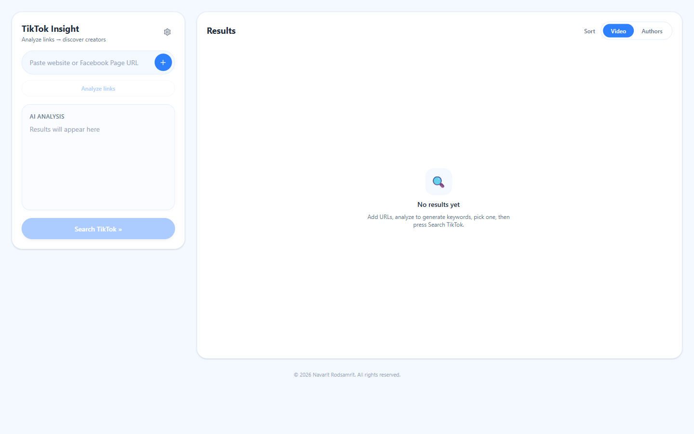

แบ่งเป็น 2 ส่วน
- **ซ้าย**: ใส่ลิงก์, ผล AI Analysis (keyword) และปุ่ม Search TikTok
- **ขวา**: ผลลัพธ์ สลับมุมมองได้ระหว่าง **Video** และ **Authors**

ปุ่มเฟือง (Settings) ใช้แก้ API base URL

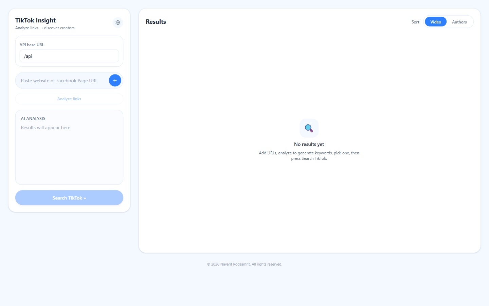

### 2.2 ใส่ลิงก์ลูกค้า

วางลิงก์เว็บหรือเพจ Facebook แล้วกด `+` ใส่ได้หลายลิงก์ (ถือว่าเป็นธุรกิจเดียวกัน)

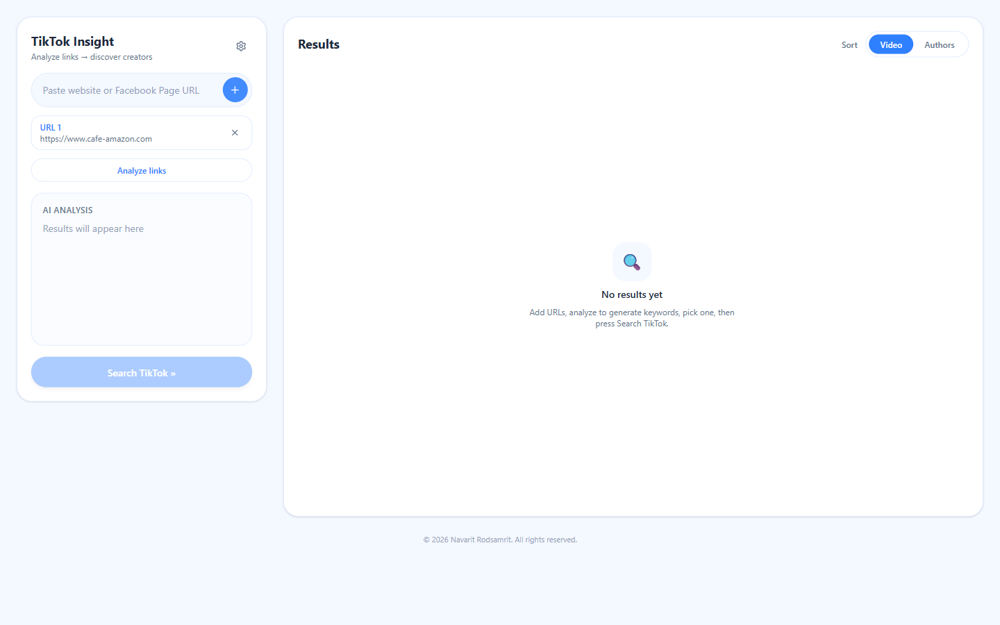

### 2.3 Analyze links → `GET /analyze`

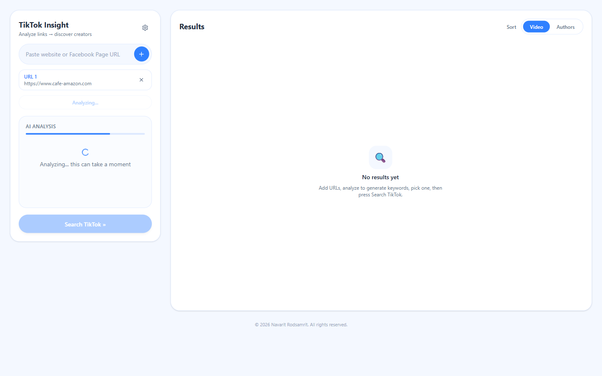

Frontend เรียก `GET /analyze?url=<ลิงก์>&url=<ลิงก์>&num_keywords=5`

ฝั่ง backend ([web_analyzer.py](../backend/src/web_analyzer.py))
1. แต่ละลิงก์ เช็ค cache ตาราง `web_pages` ก่อน
2. ลิงก์ที่ไม่มีใน cache เปิดด้วย Chromium (locale `th-TH`) รอ 1.5 วินาที แล้วอ่าน `title`, `meta[name=description]` หรือ `og:description` และ `body` text (ตัดที่ 4,000 ตัวอักษร)
3. หน้าที่อ่านได้ถูกบันทึกลง cache
4. รวมเนื้อหาทุกลิงก์ส่งให้ AI สร้าง keyword ภาษาไทยตามจำนวนที่ขอ โดยให้ตอบเป็น JSON array (ถ้า parse ไม่ได้จะ fallback แยกด้วย `,` / ขึ้นบรรทัดใหม่)

ผลลัพธ์

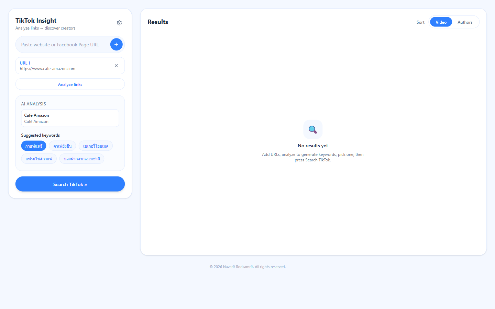

```json
{
  "page_contents": [{ "url": "...", "title": "Café Amazon", "description": "...", "text": "..." }],
  "keywords": ["กาแฟแฟร์", "คาเฟ่ยั่งยืน", "เบเกอรี่โฮมเมด", "แฟรนไชส์กาแฟ", "ของฝากจากธรรมชาติ"]
}
```

| สถานะ | สาเหตุ |
|---|---|
| 500 | ไม่มี `TYPHOON_API_KEY` |
| 502 | ดึงเนื้อหาไม่ได้เลยทุกลิงก์ หรือ AI สร้าง keyword ไม่สำเร็จ |

### 2.4 เลือก keyword

Frontend เลือก keyword แรกให้อัตโนมัติ กดเลือก / ยกเลิกได้หลายคำ คำที่เลือกจะถูกต่อกันด้วยช่องว่างเป็น query เดียว

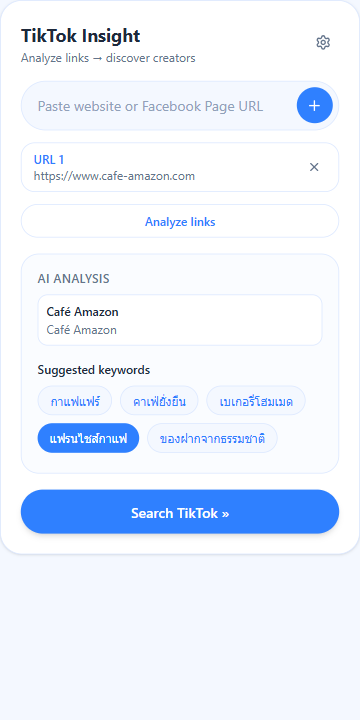

### 2.5 Search TikTok → `GET /search`

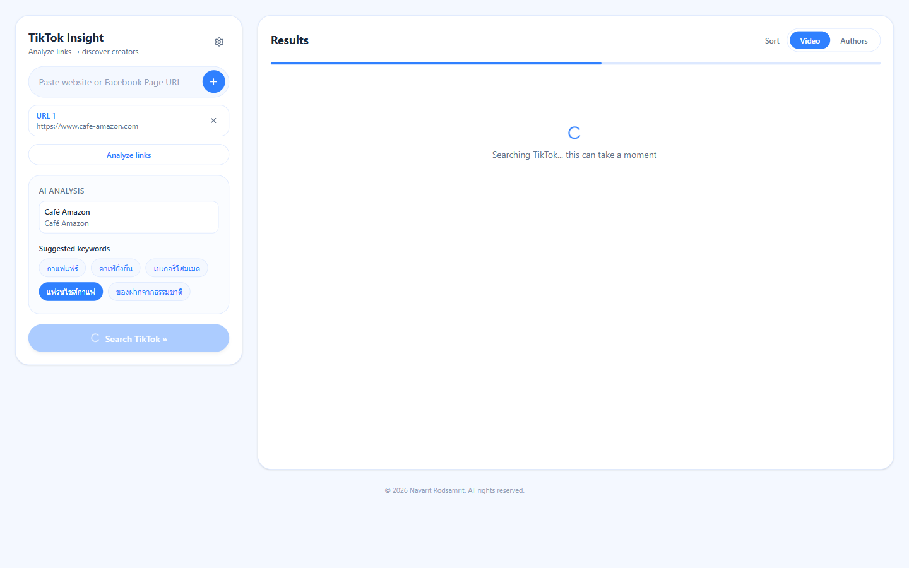

Frontend เรียก `GET /search?keyword=<keyword>&top_n=10` ใช้เวลาประมาณ 30 วินาที – 3 นาที ถ้าไม่มี cache

ฝั่ง backend ([main.py](../backend/src/main.py) → [tiktok_scraper.py](../backend/src/tiktok_scraper.py))
1. สร้าง `request_key` จาก keyword ที่เรียงแล้ว + `top_n` แล้วเช็คตาราง `search_results` ถ้ามีคืนทันทีพร้อม `from_cache: true`
2. เข้าคิว `BrowserPoolManager` (ดูหัวข้อ 4)
3. แต่ละ keyword เช็คตาราง `tiktok_searches` ถ้าไม่มี
   - เปิด `https://www.tiktok.com/search?q=<keyword>` ด้วย stealth context (UA จริง, `th-TH`, `Asia/Bangkok`, geolocation กรุงเทพ, cookies)
   - block รูป / วิดีโอ / ฟอนต์ เพื่อให้โหลดเร็ว
   - ดัก response ของ `api/search/general/full/` รอ 10 วินาที แล้ว reload อีก 10 วินาที
   - ถ้าไม่ได้ข้อมูล บันทึก screenshot + HTML ไว้ที่ `debug_captures/`
4. รวมวิดีโอทุก keyword ตัดซ้ำด้วย video id
5. **Top videos** = เรียงตามยอดไลค์ เอา `top_n` อันดับแรก แล้วเติม `author_followers` / `author_total_likes` โดยเปิดหน้าโปรไฟล์อ่าน `[data-e2e="followers-count"]` และ `likes-count` (cache ในตาราง `tiktok_profiles`)
6. **Top authors** = รวมวิดีโอตาม author (เก็บยอดไลค์สูงสุด) เอา 20 คนแรก ดึงยอดผู้ติดตาม แล้วเรียงตาม `(followers, top_likes)` เอา `top_n` คน
7. ส่งข้อมูลย่อ (คำอธิบาย 200 ตัวอักษร, hashtag 10 อัน, stats, engagement rate, วันที่โพสต์) ให้ AI ผ่าน `explain_top_results` ได้ `summary` + เหตุผลรายวิดีโอ / ราย author
8. บันทึก `search_results` เฉพาะกรณี AI สำเร็จ ถ้า AI ล้มเหลวจะคืนผล scrape พร้อม `ai_warning` และไม่ cache เพื่อให้ครั้งหน้าวิเคราะห์ใหม่

**มุมมอง Video**: แต่ละการ์ดแสดงปก, คำอธิบาย, hashtag, ยอดวิว / ไลค์ / คอมเมนต์ / แชร์, วันที่โพสต์, ลิงก์ไป TikTok, เหตุผลจาก AI และข้อมูล author ด้านขวา

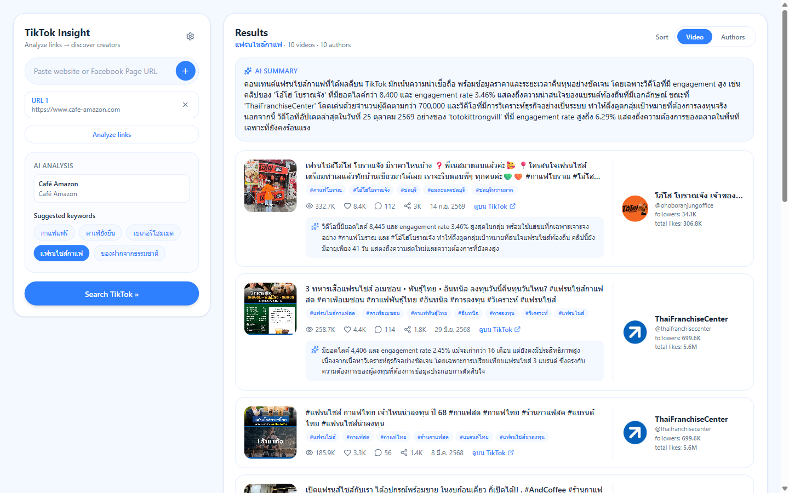

**มุมมอง Authors**: เรียงตามยอดผู้ติดตาม พร้อมเหตุผลจาก AI และปุ่ม **วิเคราะห์ช่อง**

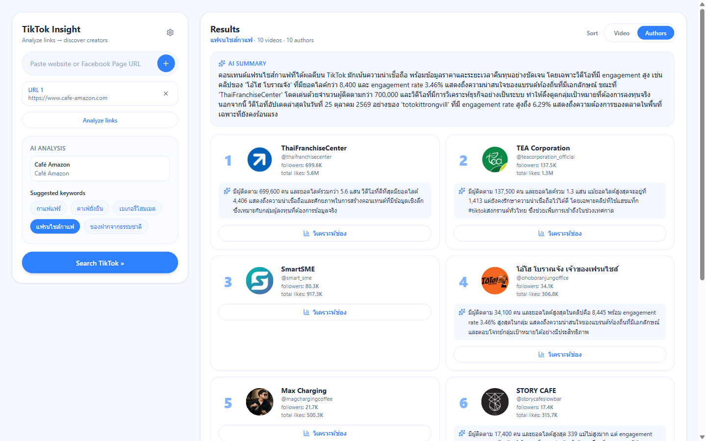

**Engagement rate** = `(likes + comments + shares) / plays × 100` ([top_analyzer.py](../backend/src/top_analyzer.py) `_engagement_rate`)

| สถานะ | สาเหตุ |
|---|---|
| 429 | คิวรอเกิน 10 request |
| 502 | ไม่ได้ผลค้นหาเลย (โดนบล็อก, cookie หมดอายุ, TikTok เปลี่ยน endpoint) |

### 2.6 วิเคราะห์ช่อง → `GET /channel`

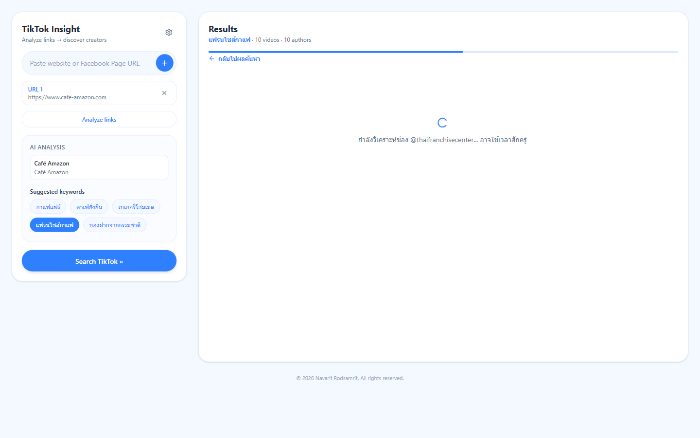

Frontend เรียก `GET /channel?unique_id=<id>&max_videos=20&context=<ชื่อเว็บลูกค้า, keyword>` โดย `context` ประกอบจาก title ของหน้าเว็บที่วิเคราะห์ + keyword ที่เลือก เพื่อให้ AI ประเมิน brand fit กับลูกค้าคนนี้

ฝั่ง backend
1. normalize `unique_id` รับได้ทั้ง `name`, `@name` และลิงก์ `https://www.tiktok.com/@name`
2. เช็คตาราง `channel_analyses` (key รวม `unique_id`, `max_videos`, `context`)
3. `scrape_channel` เช็คตาราง `tiktok_channels` ก่อน ถ้ามีวิดีโอพอใช้เลย ถ้าไม่มี
   - เปิดหน้าโปรไฟล์ อ่าน JSON ใน `<script id="__UNIVERSAL_DATA_FOR_REHYDRATION__">` → `webapp.user-detail.userInfo` (ใช้ `statsV2` ที่เป็นตัวเลขเต็มก่อน `stats` ที่ปัดเศษ)
   - ดัก response `/api/post/item_list/` เพื่อเก็บวิดีโอ
   - ถ้าเจอ captcha รอให้คนแก้เองในหน้าต่าง Chrome ได้ `CAPTCHA_WAIT_SECONDS` วินาที
   - scroll ลงสูงสุด 3 ครั้งจนได้ครบ `max_videos`
   - เรียงวิดีโอตามวันที่โพสต์ใหม่สุด แล้วบันทึก `tiktok_channels` และ `tiktok_profiles`
4. `compute_channel_metrics` คำนวณตัวเลขเองใน Python (ไม่ให้ AI คิดเลข เพื่อให้ตัวเลขถูกต้อง)
5. `analyze_channel` ส่ง profile + metrics + วิดีโอล่าสุด + context ให้ AI ตอบเป็น JSON
6. บันทึก `channel_analyses` พร้อม `brand_fit_score` เป็นตัวเลข (รองรับ AI ตอบ `9`, `"9"` หรือ `"9/10"`)

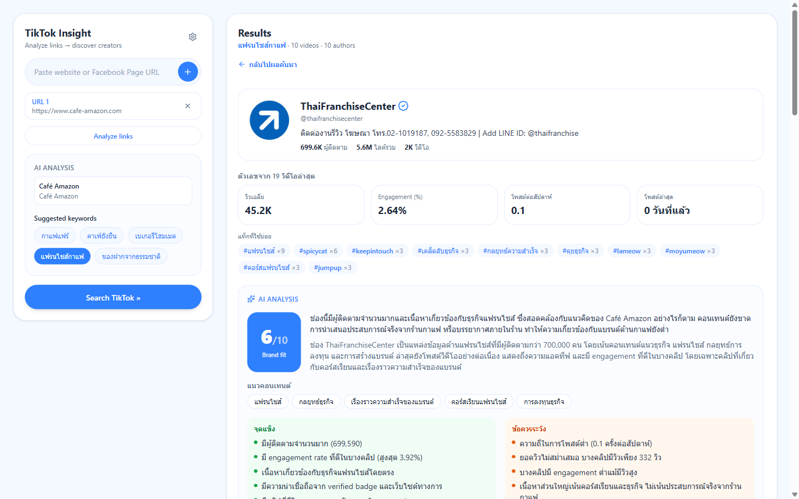

**Metrics** ที่คำนวณ

| field | วิธีคิด |
|---|---|
| `avg_plays` / `median_plays` / `max_plays` | จากยอดวิวของวิดีโอที่ดึงมา |
| `avg_engagement_rate_percent` | ค่าเฉลี่ย engagement rate รายวิดีโอ |
| `posts_per_week` | `จำนวนวิดีโอ / ช่วงวันระหว่างคลิปเก่าสุดกับใหม่สุด × 7` |
| `days_since_last_post` | วันนับจากคลิปล่าสุดถึงวันนี้ |
| `top_hashtags` | hashtag ที่ใช้บ่อยสุด 10 อันดับ (ตัวพิมพ์เล็ก) |

**AI analysis** ที่ได้: `summary`, `content_themes`, `posting_behavior`, `performance`, `audience`, `strengths`, `concerns`, `brand_fit`, `brand_fit_score` (1–10), `collaboration_ideas`

ภาพเต็มหน้า:

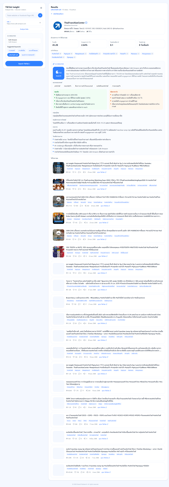

| สถานะ | สาเหตุ |
|---|---|
| 400 | `unique_id` ว่าง |
| 429 | คิวเต็ม |
| 502 | อ่านโปรไฟล์ไม่ได้ (ไม่มีช่องนี้, โดนบล็อก, cookie หมดอายุ) |
| 200 + `ai_warning` | ไม่มีวิดีโอ (ช่องว่าง / ส่วนตัว) หรือ AI ล้มเหลว |

---

## 3. API Reference

ดูและทดลองเรียกได้ที่ `http://127.0.0.1:8000/docs` (Swagger UI ที่ FastAPI สร้างให้)

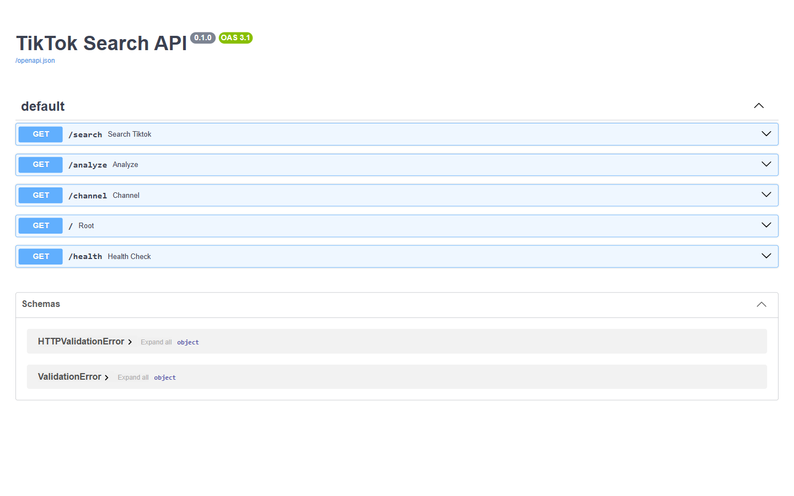

| Endpoint | Parameter | ค่าเริ่มต้น / ช่วง |
|---|---|---|
| `GET /analyze` | `url` (หลายค่าได้) | จำเป็น |
| | `num_keywords` | 3 (1–5) |
| `GET /search` | `keyword` (หลายค่าได้) | จำเป็น |
| | `top_n` | `TOP_N` = 10 (1–50) |
| | `include_author_stats` | true |
| `GET /channel` | `unique_id` | จำเป็น |
| | `max_videos` | 20 (5–35) |
| | `context` | ไม่ใส่ก็ได้ |

ทุก response ของ `/search` และ `/channel` มี `from_cache` บอกว่ามาจาก cache หรือไม่

---

## 4. การจัดคิว browser

[browser_pool.py](../backend/src/browser_pool.py) ใช้กับ `/search` และ `/channel`

- `asyncio.Semaphore(MAX_CONCURRENT_BROWSERS)` จำกัด browser ที่รันพร้อมกัน (default 3 ประมาณ 500MB ต่อ browser)
- `ThreadPoolExecutor` รันฟังก์ชัน scrape แบบ sync (Playwright sync API) โดยไม่บล็อก event loop
- นับ request ที่รอหรือกำลังรัน ถ้าเกิน `MAX_QUEUE_SIZE` = 10 ตอบ 429 ทันที

`/analyze` ไม่ผ่าน pool นี้ แต่รันใน threadpool ของ FastAPI

---

## 5. Cache (Supabase)

โครงสร้างอยู่ที่ [backend/supabase/schema.sql](../backend/supabase/schema.sql) ทุกตารางมี key, คอลัมน์สำหรับ query, `data` (jsonb) และ `created_at`

| ตาราง | key | ใช้โดย | เก็บอะไร |
|---|---|---|---|
| `web_pages` | `url` | /analyze | เนื้อหาหน้าเว็บลูกค้า |
| `tiktok_searches` | `search_url` | /search | ผลค้นหาดิบต่อ 1 keyword |
| `tiktok_profiles` | `profile_url` | /search, /channel | followers, total_likes |
| `tiktok_channels` | `profile_url` | /channel | โปรไฟล์เต็ม + วิดีโอล่าสุด |
| `search_results` | `request_key` | /search | response ที่ AI วิเคราะห์แล้ว |
| `channel_analyses` | `request_key` | /channel | response ที่ AI วิเคราะห์แล้ว + `brand_fit_score` |

- **TTL 2 วัน**: แอปไม่อ่านแถวที่เก่ากว่า `CACHE_TTL` และ `pg_cron` job `purge-cache` ลบทิ้งทุกชั่วโมง
- เขียนด้วย `upsert` บน key จึงไม่มีแถวซ้ำ
- เปิด RLS โดยไม่มี policy จึงต้องใช้ service_role key
- ถ้าไม่ได้ตั้ง `SUPABASE_URL` / `SUPABASE_KEY` ระบบยังทำงานได้แต่ไม่มี cache
- cache ชั้นข้อมูลดิบช่วยให้ request ที่ต่าง `top_n` หรือ `context` ไม่ต้อง scrape ใหม่ ส่วน cache ชั้นผลลัพธ์ช่วยไม่ต้องเรียก AI ซ้ำ

---

## 6. การรับมือการบล็อกของ TikTok

| วิธี | รายละเอียด |
|---|---|
| Cookies | โหลด `cookies.json` ของบัญชี TikTok ที่ login แล้ว ถ้าไม่มีโอกาสโดนบล็อกสูงมาก |
| Stealth context | UA Chrome จริง, viewport 1366×768, locale / timezone / geolocation ไทย |
| Init script | ซ่อน `navigator.webdriver`, ปลอม `languages`, `plugins`, `window.chrome` |
| Launch args | `--disable-blink-features=AutomationControlled`, `headless=False` |
| Captcha | `/channel` รอให้คนเลื่อน slider เองในหน้าต่าง Chrome |
| Debug | เก็บ `.png` + `.html` ใน `debug_captures/` พร้อมเหตุผล (`captcha`, `login_wall`, `rate_limited`, `unknown`, `no_videos`) |

---

## 7. การตั้งค่า (`backend/.env`)

| ตัวแปร | ค่าเริ่มต้น | ใช้ที่ |
|---|---|---|
| `TYPHOON_API_KEY` | (จำเป็น) | llm.py |
| `TYPHOON_API_BASE` | `https://api.opentyphoon.ai/v1` | llm.py |
| `TYPHOON_MODEL` | `typhoon-v2.5-30b-a3b-instruct` | llm.py |
| `SUPABASE_URL` / `SUPABASE_KEY` | ไม่มี = ปิด cache | cache.py |
| `COOKIES_FILE` | `cookies.json` | tiktok_scraper.py |
| `TOP_N` | `10` | tiktok_scraper.py, main.py |
| `CAPTCHA_WAIT_SECONDS` | `90` (ตั้ง 0 ถ้ารันใน Docker) | tiktok_scraper.py |
| `MAX_CONCURRENT_BROWSERS` | `3` | browser_pool.py |

ฝั่ง frontend: `API_BASE` (env ของ Vercel / vite dev) = URL ของ backend

---

## 8. การรัน

### Local

```powershell
# backend (รันจากโฟลเดอร์ backend เพื่อให้หา .env / cookies.json เจอ)
cd backend
.\venv\Scripts\python -m uvicorn main:app --app-dir src --port 8000

# frontend
cd frontend
npm run dev        # http://localhost:5173
```

ติดตั้งครั้งแรก: `pip install -r requirements.txt`, `playwright install chromium`, `npm install`

### Docker

```powershell
cd backend
docker compose up -d --build
```

Image ใช้ `mcr.microsoft.com/playwright/python` จำกัด RAM 2GB / 2 CPU, `shm_size` 1GB และ mount `cookies.json` แบบ read-only

### Vercel (frontend)

`vercel.json` build ด้วย `npm run build` ส่ง request ทั้งหมดไป `api/ssr` และตั้ง `API_BASE` เป็น URL สาธารณะของ backend

---

## 9. Troubleshooting

| อาการ | สาเหตุที่เป็นไปได้ | วิธีแก้ |
|---|---|---|
| `Backend unreachable` (502 จาก proxy) | backend ไม่ได้รัน หรือ `API_BASE` ผิด | เช็ค `http://127.0.0.1:8000/docs` |
| /search ได้ 502 | โดนบล็อก, cookie หมดอายุ | export `cookies.json` ใหม่ แล้วดูภาพใน `debug_captures/` |
| /channel ค้างนาน | เจอ captcha | เลื่อน slider ในหน้าต่าง Chrome ที่ backend เปิด |
| 429 | request ค้างเกิน 10 | รอ หรือเพิ่ม `MAX_CONCURRENT_BROWSERS` (เพิ่ม RAM ด้วย) |
| ได้ `ai_warning` | Typhoon ล้มเหลว หรือตอบไม่เป็น JSON | เช็ค `TYPHOON_API_KEY` / quota แล้วลองใหม่ (ผลนี้ไม่ถูก cache) |
| ข้อมูลไม่อัปเดต | มาจาก cache (`from_cache: true`) | รอครบ 2 วัน หรือลบแถวใน Supabase |
| `ModuleNotFoundError: main` | รัน uvicorn โดยไม่มี `--app-dir src` | ใส่ `--app-dir src` |

---

## 10. ข้อจำกัดที่พบระหว่างทดสอบ

- **`posts_per_week` อาจต่ำผิดปกติ**: ช่อง ThaiFranchiseCenter โพสต์ล่าสุด 0 วันที่แล้วแต่ได้ 0.1 ครั้ง/สัปดาห์ เพราะวิดีโอที่ปักหมุด (pinned) ซึ่งเก่ามากถูกนับรวม ทำให้ช่วงวันยาวเกินจริง
- **AI อาจไม่ให้เหตุผลครบทุกรายการ**: เช่น SmartSME ในภาพ Authors ไม่มีกล่องเหตุผล เพราะ AI ไม่ได้ตอบ uniqueId นั้นกลับมา
- **Console warning เรื่อง React key ซ้ำ**: เมื่อวิดีโอมี hashtag ซ้ำกัน (เช่น `#spicycat`) frontend ใช้ชื่อ tag เป็น key
- **headless=False**: เครื่องที่รัน backend ต้องมีหน้าจอ (หรือ virtual display) และจะเห็นหน้าต่าง Chrome เปิดขึ้นมาทุกครั้งที่ scrape
